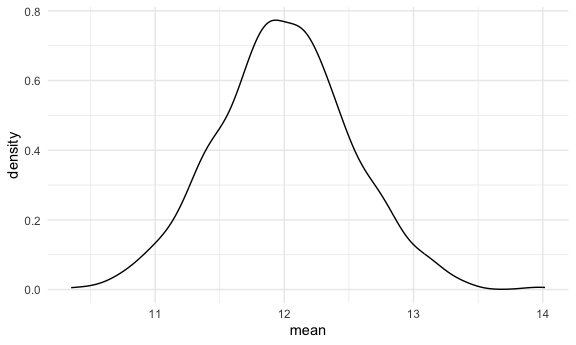
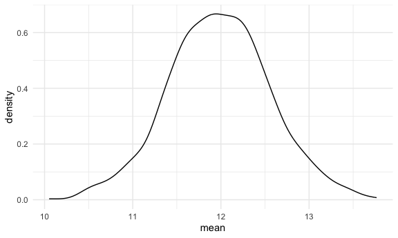
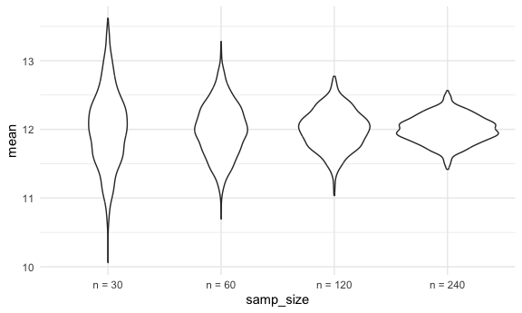

simulation
================
Emma
2026-11-10

## Repeated sampling

repeatedly draw random samples of the same size from a population.
compute the mean for each sample –\> distribution of sample means
converges to a normal distribution

We simulate this on a computer

Basic idea of simulations is to generate repeated samples under a
process you design –\> check things are working the way they are
supposed to

- define a data generating mechanism (eg. normal distribution)
- draw a random sample from that data generating mechanism
- analyze the sample (eg. compute sample mean)
- repeat
- understand the analysis approach under repeated sampling

Simulations are natural in the context of iteration

write a function to

- define data generating mechanism
- draw a sample
- analyze the sample
- return object of interest
- use a loop to analyze this many times

``` r
library(tidyverse)
```

    ## ── Attaching core tidyverse packages ──────────────────────── tidyverse 2.0.0 ──
    ## ✔ dplyr     1.2.1     ✔ readr     2.2.0
    ## ✔ forcats   1.0.1     ✔ stringr   1.6.0
    ## ✔ ggplot2   4.0.3     ✔ tibble    3.3.1
    ## ✔ lubridate 1.9.5     ✔ tidyr     1.3.2
    ## ✔ purrr     1.2.2     
    ## ── Conflicts ────────────────────────────────────────── tidyverse_conflicts() ──
    ## ✖ dplyr::filter() masks stats::filter()
    ## ✖ dplyr::lag()    masks stats::lag()
    ## ℹ Use the conflicted package (<http://conflicted.r-lib.org/>) to force all conflicts to become errors

``` r
set.seed(1)
```

``` r
source("source/sim_mean_sd.R")
```

``` r
knitr::opts_chunk$set(
  fig.width = 6,
  fig.asp = .6,
  out.width = "90%"
)

theme_set(theme_minimal() + theme(legend.position = "bottom"))

options(
  ggplot2.continuous.colour = "viridis",
  ggplot2.continuous.fill = "viridis"
)

scale_colour_discrete = scale_colour_viridis_d
scale_fill_discrete = scale_fill_viridis_d
```

# Mean and SD

Can we check central limit theorem using simulations

``` r
sim_mean_sd(n_obs = 30)
```

    ## # A tibble: 1 × 2
    ##    mean    sd
    ##   <dbl> <dbl>
    ## 1  12.2  2.77

``` r
output = vector("list", length = 1000)

for (i in 1:1000) {
  
  output[[i]] = sim_mean_sd(n_obs = 30, mu = 12, sigma = 3)
}
```

inspect results

``` r
output |> 
  bind_rows() |> 
  summarize(
    emp_m = mean(mean), #empirical mean - taking average across all 1000 numbers in mean column
    emp_se = sd(mean) #empirical standard error - sd of means in mean column 
  )
```

    ## # A tibble: 1 × 2
    ##   emp_m emp_se
    ##   <dbl>  <dbl>
    ## 1  12.0  0.522

``` r
output |> 
  bind_rows() |> 
  ggplot(aes(x = mean)) +
  geom_density() #starts to approximate normal distribution 
```



can edit sim_mean_sd.R doc –\> x = rbinom(n = n_obs, size = 1, prob =
.5)

Move output list into a df - use tibbles and map instead

``` r
sim_results_df = 
  tibble(
    samp_size = rep(30, 1000) #sample size is repeat 30 1000 times
  ) |> 
  mutate(
    est_df = map(samp_size, sim_mean_sd) #add a column, map across samp size column, applying function every time - makes dataframe of df 
  ) |> 
  unnest(est_df) #unnest so it shows in df 
```

look at results

``` r
sim_results_df |> 
  ggplot(aes(x = mean)) +
  geom_density()
```



# Change `n`

narrower sample sizes = narrower sample distributions

``` r
sim_results_df = 
  expand_grid( #create a df that has all possible combos of these two inputs
    samp_size = 30, 
    iter = 1:1000
  ) |> 
  mutate(
    est_df = map(samp_size, sim_mean_sd)
  ) |> 
  unnest(est_df)
```

``` r
sim_results_df = 
  expand_grid(
    samp_size = c(30, 60, 120, 240), #making more options for combos, running same thing a bunch of times
    iter = 1:1000
  ) |> 
  mutate(
    est_df = map(samp_size, sim_mean_sd)
  ) |> 
  unnest(est_df)
```

``` r
sim_results_df |> 
  mutate(
    samp_size = str_c("n = ", samp_size), 
    samp_size = fct_inorder(samp_size)
  ) |> 
  ggplot(aes(x = samp_size, y = mean)) +
  geom_violin()
```


